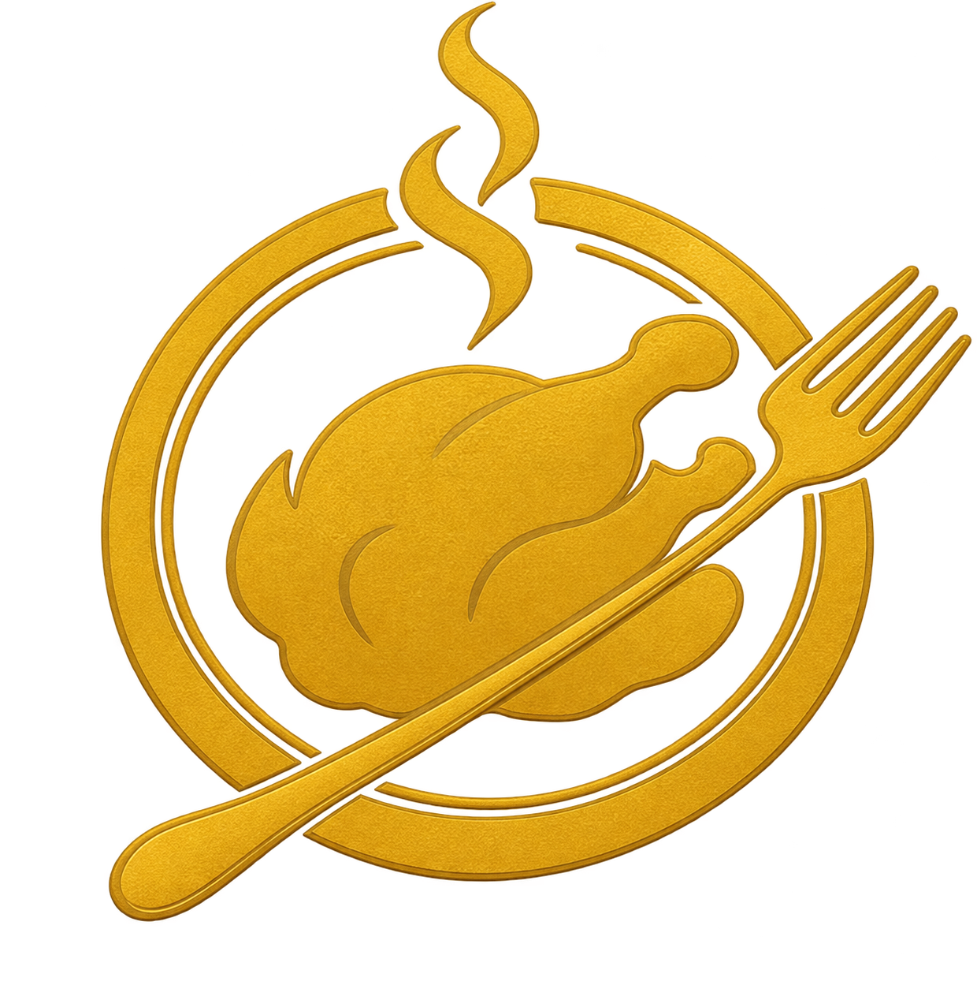

# Hungerspiele



Eine browserbasierte Quiz- und Punkte-Spielsteuerung für Hochzeiten und andere Feiern.
Entwickelt, um "fair" die Reihenfolge am Buffet festzulegen.
Das Projekt besteht aus einer Spieleransicht, einer Präsentation und einem Admin-Dashboard. 
Die Beispielrunde enthält ein allgemeines Quiz in Deutsch, Polnisch und Portugiesisch.

## Voraussetzungen

- PHP 8.0 oder neuer
- Ein PHP-fähiger Webserver
- Schreibrechte für das Verzeichnis `data/`

## Lokal testen

Im Projektverzeichnis starten:

```sh
php -S 127.0.0.1:8000
```

Danach die Ansichten öffnen:

- Spieler: <http://127.0.0.1:8000/>
- Präsentation: <http://127.0.0.1:8000/presenter.html>
- Administration: <http://127.0.0.1:8000/admin.html>

Beim ersten API-Aufruf wird `data/game.json` aus `data/game.example.json` angelegt.
`data/answer.json` enthält die Antworten einer laufenden Runde. Beide Dateien werden nicht versioniert. 
Die Beispielrunden werden aus `data/rounds.example.json` geladen.

## Eigene Inhalte

Für eigene Fragen die Datei `data/rounds.example.json` nach `data/rounds.json` kopieren und bearbeiten. 
Pro Runde werden `module`, `intro`, `elements` und für Quizfragen `question`, `answers` sowie der nullbasierte Index `correct_answer` verwendet. 
Optionale Übersetzungen heißen `intro_pl`, `intro_pt`, `question_pl`, `question_pt`, `answers_pl` und `answers_pt`.

Die JSON-Datei `data/game.json` ist der veränderliche Spielstand. 
Zum Zurücksetzen kann sie gelöscht werden; beim nächsten API-Aufruf wird wieder die Beispielkonfiguration kopiert. 
Private Namen, Fragen, Fotos, QR-Codes, Teamgrafiken und Logos aus dem ursprünglichen Spiel sind nicht Bestandteil des Git-Projekts. 
Eigene Mediendateien sollten nur mit geklärten Nutzungsrechten eingebunden werden.

## Sicherheit und Datenschutz

Die API hat derzeit keine Anmeldung oder Rollenprüfung. 
Betreibe sie daher nur in einem vertrauenswürdigen, privaten Netzwerk und stelle sie nicht unverändert öffentlich ins Internet. 
Für öffentliche Einsätze müssen insbesondere Admin-Aktionen und Schreibzugriffe abgesichert werden. 
Verwende keine echten Namen oder privaten Fotos in versionierten Beispieldateien.

## Lizenz

Der Quellcode steht unter der MIT-Lizenz. Siehe [LICENSE](LICENSE).
